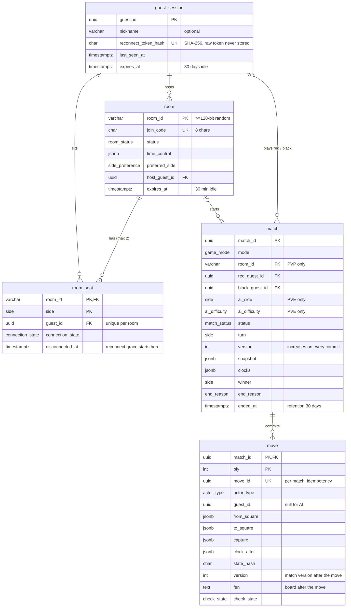

# Database

PostgreSQL 16, accessed through [Prisma](https://www.prisma.io/docs) from `apps/server`.
The schema lives in `apps/server/prisma/schema.prisma`; tables follow SRS 8.2. The database
changes only through the SQL migrations in `apps/server/prisma/migrations`.

In a service, inject `PrismaService` (available everywhere through `DatabaseModule`):

```ts
constructor(private readonly db: PrismaService) {}

findRoom(joinCode: string) {
  return this.db.room.findUnique({ where: { joinCode }, include: { seats: true } });
}
```

Prisma reports a broken unique rule as error code `P2002`; map it to the matching `DomainException`
(for example `ROOM_FULL` when a seat insert collides).

## Entity relationship diagram



## Rules enforced by the database

| Rule                                        | How                                                           | SRS   |
| ------------------------------------------- | ------------------------------------------------------------- | ----- |
| A room has at most two seats, one per side  | PK `(room_id, side)`                                          | FR-04 |
| One guest cannot take both seats            | unique `(room_id, guest_id)`                                  | FR-04 |
| A ply is committed once per match           | PK `(match_id, ply)`                                          | 8.3   |
| A retried `SubmitMove` cannot commit twice  | unique `(match_id, move_id)`                                  | 3.3   |
| A retried `SubmitMove` gets the first Ack   | `move` keeps `version`, `fen`, `check_state` of the commit    | 3.3   |
| PVE matches name the AI side and difficulty | check `chk_match_pve_has_ai` (added by hand in the migration) | FR-30 |
| Deleting a match deletes its moves          | FK `ON DELETE CASCADE`                                        | BR-20 |

## Not in this schema yet

- Accounts, refresh tokens, ranked queue and Elo settlement come with US-37 and later. `match` will
  then also reference accounts (the SRS data model only links matches to guests).
- Retention jobs (delete expired guests, rooms and old matches) come with US-46; the `expires_at`
  and `ended_at` indexes are already there for them.

## Changing the schema

1. Edit `apps/server/prisma/schema.prisma`.
2. In `apps/server`: `pnpm db:migrate:dev --name <what-changed>`. This writes a new folder under
   `prisma/migrations`, applies it to your local database and regenerates the client.
3. Read the generated `migration.sql`. Rules Prisma cannot express (check constraints such as
   `chk_match_pve_has_ai`) are written by hand in SQL; use `--create-only` first if you need to add
   some before applying.
4. Never edit a migration that is already on `main`; add a new one instead.
5. Commit `schema.prisma` and the new migration folder together. Docker and CI run
   `prisma migrate deploy`, which only applies committed migrations.
